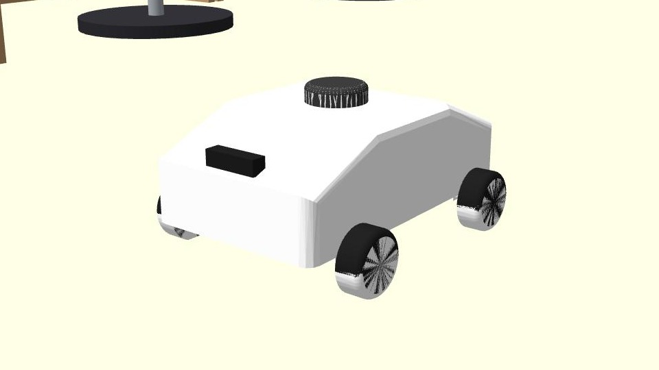
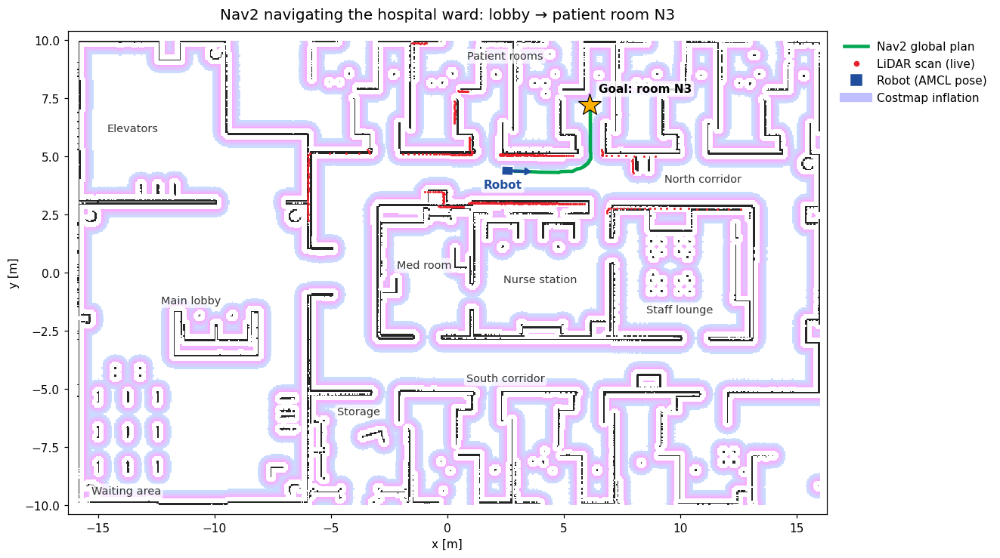
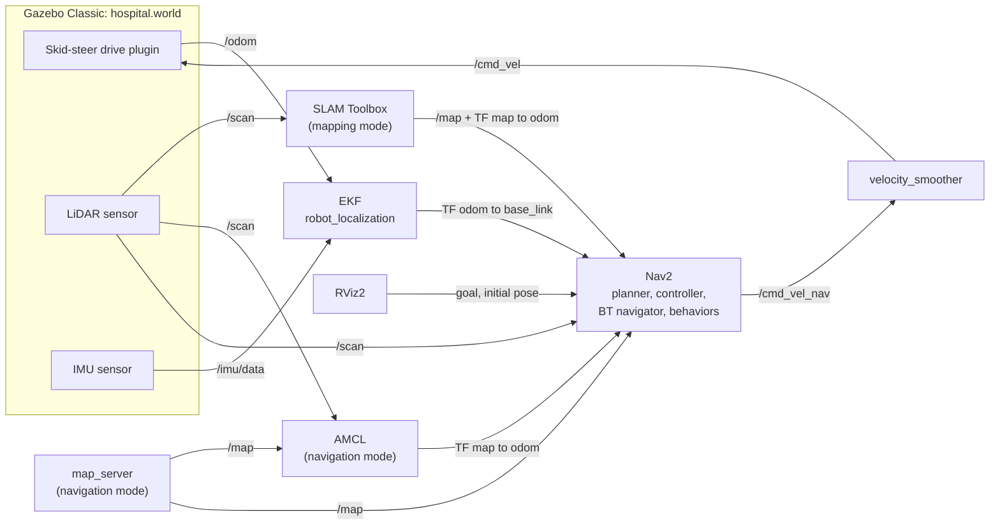
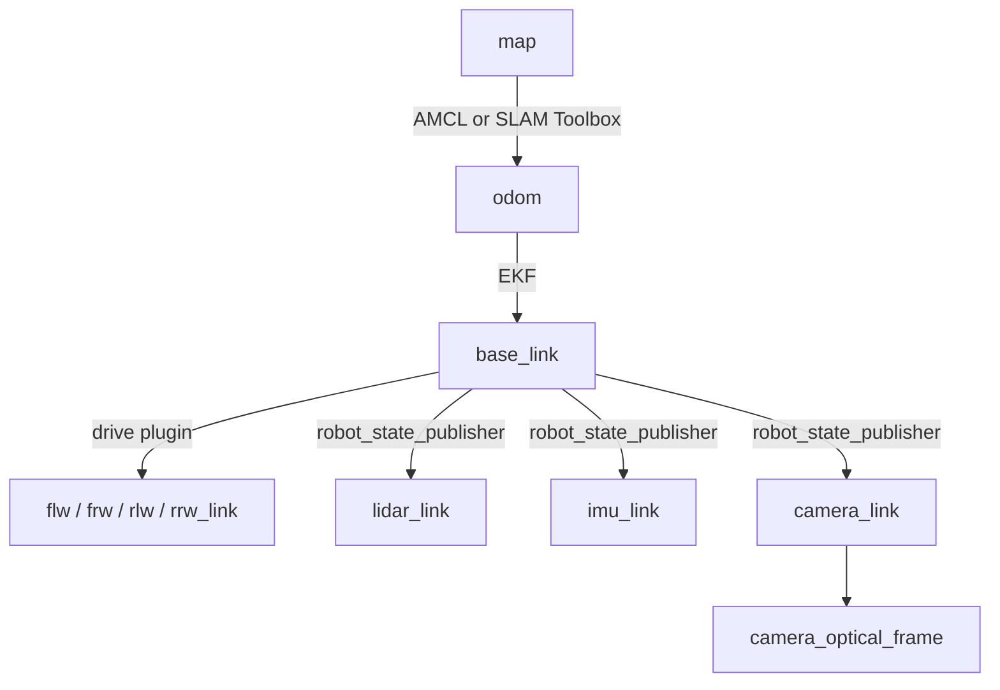

# Skid-Steer AMR in a Simulated Hospital — ROS 2 Humble · Gazebo · Nav2

[](https://docs.ros.org/en/humble/)
[](https://classic.gazebosim.org/)
[](https://docs.nav2.org/)
[](LICENSE)

A four-wheel **skid-steer autonomous mobile robot (AMR)** that maps, localizes
and navigates a realistic **32 × 20 m hospital floor** in simulation. It fuses
wheel odometry and an IMU with an EKF, builds maps with SLAM Toolbox,
localizes with AMCL and drives autonomously with Nav2. A front camera is being
added for perception.

Everything is written to be read and reused: if you want to build a similar
skid-steer robot in ROS 2, the robot description, launch files and
configuration are commented and modular, and the problems met along the way
are documented below.


## Contents

- [Highlights](#highlights)
- [Gallery](#gallery)
- [System architecture](#system-architecture)
- [The robot](#the-robot)
- [The hospital world](#the-hospital-world)
- [Installation](#installation)
- [Usage: step by step](#usage-step-by-step)
- [Customising](#customising)
- [Checking that everything works](#checking-that-everything-works)
- [Troubleshooting](#troubleshooting)
- [Measured performance](#measured-performance)
- [Engineering notes](#engineering-notes)
- [Package layout](#package-layout)
- [Known limitations](#known-limitations)
- [Roadmap](#roadmap)

## Highlights

- **Four-wheel skid-steer drive** in Gazebo Classic with correctly modelled
  wheel friction, so the robot can turn on the spot like a real skid-steer base.
- **Realistic hospital ward** built from real-world dimensions: lobby,
  reception, patient rooms with beds and IV stands, nurse station, corridors
  with handrails, carts and wheelchairs. Generated by a readable Python script.
- **Full navigation stack:** EKF odometry fusion → SLAM Toolbox mapping →
  AMCL localization → Nav2 path planning and control.
- **Measured, not assumed:** turning rate, sensor rates, map accuracy against
  ground truth and localization error are all reported below.
- **Headless mode** (`gui:=false`) for repeatable automated tests.

| Area | Implementation | Status |
|---|---|---|
| Robot model | Modular URDF/xacro from CAD (STL meshes) | ✅ |
| Drive | `gazebo_ros_diff_drive` with two wheel pairs (skid-steer) | ✅ |
| Sensors | 360° 2D LiDAR (`/scan`), IMU (`/imu/data`) | ✅ |
| Odometry fusion | `robot_localization` EKF: wheel odometry + IMU yaw rate | ✅ |
| Mapping | SLAM Toolbox (online async) | ✅ |
| Localization | Nav2 map server + AMCL | ✅ |
| Navigation | Nav2: NavFn planner, DWB controller, recovery behaviours | ✅ |
| Camera | Mount and TF frames in place | 🚧 sensor plugin next |

## Gallery

| | |
|---|---|
|  |  |
| **The robot** in the hospital lobby: 2D LiDAR on top, camera on the nose | **North corridor** with handrails, room doors and parked carts |
|  |  |
| **Nav2 navigating** across the ward: planned path, inflated costmap, live LiDAR scan | **The SLAM map** of the whole floor, built with SLAM Toolbox |

## System architecture

How the nodes connect. In **mapping** mode SLAM Toolbox provides the map and
the `map → odom` transform; in **navigation** mode map server + AMCL do.



The TF tree, and which node publishes each transform:



| Topic | Type | Publisher | Rate |
|---|---|---|---|
| `/cmd_vel` | `geometry_msgs/Twist` | Nav2 velocity smoother or teleop | — |
| `/odom` | `nav_msgs/Odometry` | Gazebo drive plugin | 100 Hz |
| `/odometry/filtered` | `nav_msgs/Odometry` | EKF | 30 Hz |
| `/scan` | `sensor_msgs/LaserScan` | Gazebo LiDAR | 10 Hz |
| `/imu/data` | `sensor_msgs/Imu` | Gazebo IMU | 100 Hz |
| `/map` | `nav_msgs/OccupancyGrid` | map server or SLAM Toolbox | latched |
| `/clock` | `rosgraph_msgs/Clock` | Gazebo | 100 Hz |

## The robot

| Property | Value |
|---|---|
| Drive | 4-wheel skid-steer (left and right wheel pairs driven differentially) |
| Chassis | 0.50 × 0.40 m |
| Wheels | 4 × Ø 0.10 m, wheelbase 0.32 m, track 0.36 m |
| Mass | ≈ 21.6 kg |
| LiDAR | 360°, 720 samples, 0.12–12 m, 10 Hz, scan plane 0.22 m above the floor |
| IMU | 100 Hz |
| Camera | Front, 0.23 m ahead of centre, below the LiDAR scan plane |

The description is split into one xacro file per component, so a sensor can
be moved or swapped by editing a single file:

| File | Contents |
|---|---|
| [`skid_steer_amr.urdf.xacro`](src/skid_steer_amr/urdf/skid_steer_amr.urdf.xacro) | Top level: includes the files below |
| [`robot_core.xacro`](src/skid_steer_amr/urdf/robot_core.xacro) | Chassis, wheel macro, wheel friction |
| [`lidar.xacro`](src/skid_steer_amr/urdf/lidar.xacro) | LiDAR link and Gazebo ray sensor |
| [`imu.xacro`](src/skid_steer_amr/urdf/imu.xacro) | IMU link and Gazebo IMU sensor |
| [`camera.xacro`](src/skid_steer_amr/urdf/camera.xacro) | Camera link and optical frame |
| [`gazebo_control.xacro`](src/skid_steer_amr/urdf/gazebo_control.xacro) | Skid-steer drive plugin |

## The hospital world

A single-floor hospital ward built from real-world dimensions (2.4 m
corridors, 1.2 m room doors, ~4.4 × 4.8 m patient rooms, 2.8 m walls):

```
  y=10 +---------+------+------+------+------+------+
       | elevator| WC   | N1   | N2   | N3   | N4   | N5      patient rooms
       |  lobby  +------+------+------+------+------+------+
  y=3  +---  ---+       |          north corridor          |
       |         |   +--+----------+----------+--------+   |
       |  main   |  ward | med room | nurse    | staff  |   |
       |  lobby  |  doors|          | station  | lounge |   |
       |         |   +--+----------+----------+--------+   |
       |reception|       |          south corridor          |
       |         +------+------+------+------+------+------+
       | waiting | S1 storage  | S2   | S3   | S4 two-bed  |
  y=-10+---[entrance]---+------+------+------+-------------+
     x=-16             x=-6                               x=16
```

- **Racetrack ward:** two corridors around a central core (medication room,
  nurse station, staff lounge), as in many real wards. It also gives SLAM a
  loop to close.
- **Furnished:** hospital beds, IV stands, over-bed tables, privacy curtains,
  en-suite bathrooms, wheelchairs, medication/linen/crash carts, handrails,
  reception desk, waiting seats, elevators, car park.
- **Sensor-realistic:** the 2D LiDAR sees bed bases, cabinets and furniture
  legs; mattresses, table tops and handrails are above its scan plane, as
  with a real 2D LiDAR. That is exactly the gap a depth camera fills.
- **Fast:** collision shapes exist only below 0.4 m (everything the robot can
  touch or the LiDAR can see), which keeps the simulation at real-time speed.

The world file is generated by
[`scripts/generate_hospital_world.py`](src/skid_steer_amr/scripts/generate_hospital_world.py)
(see [Customising](#customising)).

## Installation

**Requirements:** Ubuntu 22.04, [ROS 2 Humble](https://docs.ros.org/en/humble/Installation/Ubuntu-Install-Debians.html)
(desktop), Gazebo Classic 11.

**1. Install the dependencies:**

```bash
sudo apt update
sudo apt install ros-humble-gazebo-ros-pkgs ros-humble-xacro \
  ros-humble-robot-state-publisher ros-humble-joint-state-publisher-gui \
  ros-humble-robot-localization ros-humble-slam-toolbox \
  ros-humble-navigation2 ros-humble-nav2-bringup \
  ros-humble-teleop-twist-keyboard python3-colcon-common-extensions
```

Or let `rosdep` read them from `package.xml` (after step 2):

```bash
sudo rosdep init   # first time only
rosdep update
rosdep install --from-paths src --ignore-src -y
```

**2. Clone and build:**

```bash
git clone https://github.com/jaykumbharkar/ros2-amr-navigation.git ~/robot_ws
cd ~/robot_ws
colcon build --symlink-install
```

**3. Source the workspace** (in every new terminal, or add it to `~/.bashrc`):

```bash
source /opt/ros/humble/setup.bash
source ~/robot_ws/install/setup.bash
```

## Usage: step by step

### 1. Look at the robot model

```bash
ros2 launch skid_steer_amr display.launch.py
```

In RViz set **Fixed Frame** to `base_link`, then **Add → RobotModel** and
**Add → TF**. The slider window turns the wheels.

### 2. Build a map (SLAM)

The repository already contains a map of the hospital. Follow these steps to
build your own, for example after changing the world.

**Terminal 1:** start Gazebo, the EKF, SLAM Toolbox and RViz:

```bash
ros2 launch skid_steer_amr bringup_mapping.launch.py
```

**Terminal 2:** drive the robot with the keyboard:

```bash
ros2 run teleop_twist_keyboard teleop_twist_keyboard
```

| Key | Action |
|---|---|
| `i` / `,` | forward / backward |
| `j` / `l` | turn left / right |
| `k` | stop |
| `z` / `q` | slower / faster |

**Tips for a clean map:**
1. Press `z` three or four times first: SLAM produces cleaner maps at low speed.
2. Turn slowly and avoid long spins on the spot.
3. Drive the **full corridor loop** and return to where you started, so SLAM
   can close the loop.
4. Drive into each room through its door.

**Terminal 3:** save the map into the package when the map in RViz looks complete:

```bash
ros2 run nav2_map_server map_saver_cli -f ~/robot_ws/src/skid_steer_amr/maps/hospital_map
```

This writes `hospital_map.yaml` (metadata) and `hospital_map.pgm` (image).

### 3. Navigate autonomously

```bash
ros2 launch skid_steer_amr bringup_navigation.launch.py
```

Wait about 20 seconds: the launch file starts Gazebo, then the EKF, then
localization, then Nav2, then RViz.

1. **Check localization.** In RViz the red LiDAR points should lie on the
   map walls. If they do not, click **2D Pose Estimate**, click the robot's
   real position on the map and drag in the direction it is facing.
2. **Send a goal.** Click **2D Goal Pose**, click the destination and drag to
   set the final heading. Nav2 plans a path and drives there.

Goals can also be sent from the command line, which is useful for scripted
tests. For example, into patient room N3:

```bash
ros2 action send_goal /navigate_to_pose nav2_msgs/action/NavigateToPose \
  "{pose: {header: {frame_id: map}, pose: {position: {x: 6.1, y: 7.2}, orientation: {w: 1.0}}}}"
```

### 4. Run without windows (headless)

Both bringup files accept `gui:=false`, which skips the Gazebo and RViz
windows. This uses far less CPU and is meant for automated tests:

```bash
ros2 launch skid_steer_amr bringup_navigation.launch.py gui:=false
```

## Customising

**Move or tilt the camera:** edit the four properties at the top of
[`camera.xacro`](src/skid_steer_amr/urdf/camera.xacro) (`cam_x`, `cam_y`,
`cam_z`, `cam_pitch`). Keep it below the LiDAR scan plane so it does not block
`/scan`.

**Change the hospital:** edit
[`generate_hospital_world.py`](src/skid_steer_amr/scripts/generate_hospital_world.py)
(the floor plan is in `building()`, the furniture in `furnish()`), then
regenerate the world and build a new map:

```bash
python3 ~/robot_ws/src/skid_steer_amr/scripts/generate_hospital_world.py
```

**Start somewhere else:** pass a spawn pose, and set the same pose as
`initial_pose` for AMCL in [`nav2_params.yaml`](src/skid_steer_amr/config/nav2_params.yaml):

```bash
ros2 launch skid_steer_amr bringup_navigation.launch.py x:=-4.5 y:=3.9 yaw:=0.0
```

**Use a different world:** put the `.world` file in `worlds/` and pass
`world:=my_world.world` (with a matching spawn pose and map).

## Checking that everything works

With the navigation launch running, in a second terminal:

```bash
ros2 topic hz /scan                 # ~10 Hz
ros2 topic hz /odometry/filtered    # ~30 Hz
ros2 run tf2_ros tf2_echo map base_link
ros2 run tf2_tools view_frames      # writes frames_*.pdf with the TF tree
```

**Turning test** (stops Nav2 from driving while it runs; press Ctrl+C after a
few seconds):

```bash
ros2 topic pub -r 20 /cmd_vel geometry_msgs/msg/Twist "{angular: {z: 1.0}}"
```

In another terminal, the yaw rate should read about 0.85–0.9 rad/s:

```bash
ros2 topic echo /imu/data --field angular_velocity.z
```

## Troubleshooting

| Symptom | Cause | Fix |
|---|---|---|
| `package 'skid_steer_amr' not found` | Workspace not sourced in this terminal | `source ~/robot_ws/install/setup.bash` |
| Nav2 never becomes active; log shows `failed to send response ... (timeout)` | Stale Fast DDS shared-memory files from processes that were killed | Stop everything, run `fastdds shm clean`, launch again |
| RViz: LiDAR points do not match the map, robot drawn in the wrong place | AMCL lost track of the robot | **2D Pose Estimate** at the robot's real position |
| Robot meshes missing in Gazebo | `GAZEBO_MODEL_PATH` not set | Launch through `gazebo.launch.py`, which sets it |
| Simulation slow (real-time factor well below 1) | Not enough CPU, e.g. two simulations running | Close other simulations; use `gui:=false` |
| Robot drives straight but hardly turns | Wheel friction direction missing (only if you edit the wheels) | Keep `<fdir1>0 0 1</fdir1>` in the wheel macro; see [Engineering notes](#engineering-notes) |
| Goal far away fails during mapping | Goal is outside the map built so far | Explore towards it in steps |

## Measured performance

Measured in this simulation (laptop: AMD Ryzen 5 4600HS, GTX 1650 Ti, 8 GB RAM).

| Measurement | Result |
|---|---|
| Turn in place, commanded 1.0 rad/s | 0.85–0.92 rad/s (normal skid-steer slip) |
| Straight line, commanded 0.20 m/s | 0.200 m/s |
| Real-time factor, full stack headless | 0.96 |
| Sensor / filter rates | `/scan` 10 Hz, `/imu/data` 100 Hz, `/odometry/filtered` 30 Hz, `/clock` 100 Hz |
| SLAM map accuracy vs. true geometry | 95 % of mapped obstacles within 0.15 m |
| Autonomous exploration tour (49 goals, every room) | 46 / 49 goals reached |
| AMCL localization error vs. ground truth | ward: mean 0.10 m · lobby: mean 0.17 m, max 0.50 m |

## Engineering notes

Problems found while building this robot, and how they were solved. Useful if
you build a similar one.

- **A skid-steer robot that could not turn.** It drove straight perfectly but
  turned at 2 % of the commanded rate. Wheel friction had `mu1 = 1.0` and
  `mu2 = 0.3` but no friction *direction*, so Gazebo put the high friction
  sideways and the robot could not skid. Setting `fdir1` along the wheel axle
  (`0 0 1`, in the collision frame) with low sideways friction restored
  turning to 85–90 % of the commanded rate.
- **Wheel separation:** the wheel joints are 0.32 m apart, but each wheel is
  offset 2 cm outward, so the real track width is 0.36 m. The drive plugin
  now computes it from the wheel dimensions.
- **EKF stuck at 10 Hz:** Gazebo publishes `/clock` at 10 Hz by default, and
  nodes on simulation time cannot run faster than the clock. Raising it to
  100 Hz (`config/gazebo_params.yaml`) let the EKF run at its configured 30 Hz.
- **Portable meshes:** mesh paths were absolute (`file:///home/...`) and
  broke on any other computer. They are now `package://` paths.
- **Real-time world:** giving collision shapes only to objects below 0.4 m
  cut collision shapes from 658 to 397 without changing what the robot or
  LiDAR experience.

## Package layout

```
src/skid_steer_amr/
├── urdf/        # modular robot description (see "The robot")
├── launch/
│   ├── bringup_mapping.launch.py     # Gazebo + EKF + SLAM Toolbox + RViz
│   ├── bringup_navigation.launch.py  # Gazebo + EKF + AMCL + Nav2 + RViz
│   ├── gazebo.launch.py              # world + robot spawn (args: world, x, y, yaw, gui)
│   ├── ekf.launch.py                 # robot_localization EKF
│   ├── localization.launch.py        # map server + AMCL
│   ├── navigation.launch.py          # Nav2 servers
│   └── display.launch.py             # model only, in RViz
├── config/      # ekf.yaml, nav2_params.yaml, mapper_params_online_async.yaml, gazebo_params.yaml
├── maps/        # hospital_map.yaml / .pgm
├── worlds/      # hospital.world (generated)
├── scripts/     # generate_hospital_world.py
├── meshes/      # STL files exported from CAD
└── rviz/        # hospital_nav.rviz
```

## Known limitations

Documented deliberately; most are next on the roadmap.

- **Odometry is ground truth.** `gazebo_ros_diff_drive` publishes the
  simulator's true pose on `/odom` by default, so wheel slip is not modelled
  and the EKF and AMCL have little to correct.
- **EKF trusts wheel yaw.** Fine for ground-truth odometry; with real wheel
  odometry the IMU yaw rate should dominate.
- **Collision box and Nav2 footprint are smaller than the chassis**
  (0.20 × 0.28 m box, 0.22–0.25 m radius vs. a 0.50 × 0.40 m body).
- **Nav2 parameters** are mostly Nav2/TurtleBot defaults (0.26 m/s maximum
  speed), and the acceleration limits exceed the drive plugin's 1.0 m/s².
  The 1.1 m door between the nurse station and the staff lounge is too tight
  for the current inflation settings (the lounge is reachable through its
  1.2 m corridor door).
- **AMCL uses default tuning.** With unmapped obstacles blocking a corridor
  (repeated spin and back-up recoveries), AMCL has been seen to lose the
  robot by ~2.8 m; re-localize with **2D Pose Estimate**.

## Roadmap

1. AMCL tuning, tested against obstacles that are not on the map
2. Camera sensor (RGB-D) with image, camera info and point-cloud topics
3. Object and person detection (YOLO) with distance from depth
4. Realistic wheel odometry, EKF retuning, matched footprint and collision model
5. Depth point cloud in the Nav2 local costmap; people-aware navigation
6. Waypoint missions, docking, performance evaluation

## Author

**Jay Kumbharkar**: Production Engineering graduate studying robotics and
mechatronics. [GitHub](https://github.com/jaykumbharkar)

## License

[Apache-2.0](LICENSE)
