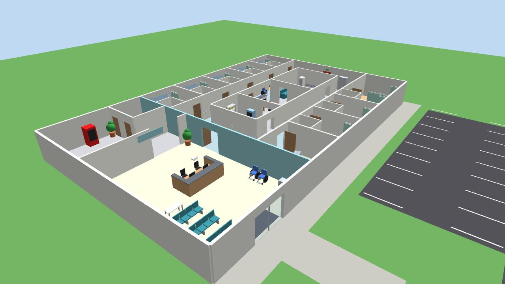
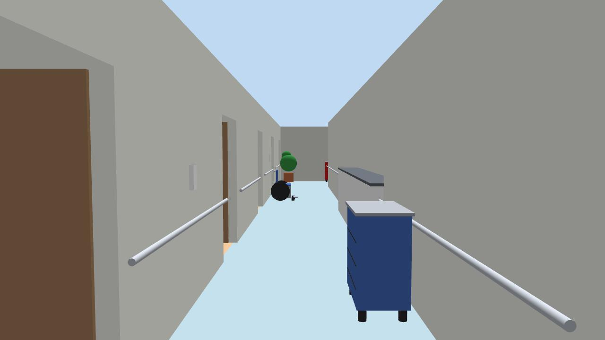
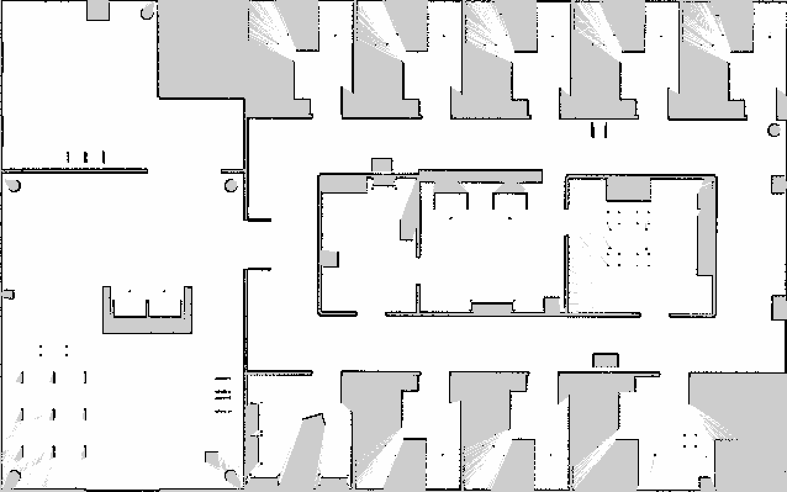

# Skid-Steer AMR — ROS 2 Humble + Gazebo Classic

A four-wheel skid-steer autonomous mobile robot (AMR), simulated in a
32 × 20 m hospital floor. It maps the environment with SLAM Toolbox, localizes with AMCL
and navigates autonomously with Nav2, using a 2D LiDAR, an IMU and wheel
odometry fused by an EKF. A front camera is being added for perception.

The robot model, configuration and launch files are written to be readable
and reusable if you want to build a similar skid-steer robot.

## Features

| Area | Implementation | Status |
|---|---|---|
| Robot model | URDF/xacro from CAD (STL meshes), four driven wheels | ✅ |
| Drive | `gazebo_ros_diff_drive` with two wheel pairs (skid-steer) | ✅ |
| Sensors | 360° LiDAR (`/scan`), IMU (`/imu/data`) | ✅ |
| Odometry fusion | `robot_localization` EKF: wheel odometry + IMU yaw rate | ✅ |
| Mapping | SLAM Toolbox (online async), saved `hospital_map` | ✅ |
| Localization | Nav2 map server + AMCL | ✅ |
| Navigation | Nav2 (NavFn planner, DWB controller, recovery behaviours) | ✅ |
| Camera | Mount and TF frames | 🚧 sensor plugin next |

## The hospital world



A single-floor hospital ward built from real-world dimensions (2.4 m
corridors, 1.2 m room doors, ~4.4 × 4.8 m patient rooms, 2.8 m walls):

```
  y=10 +---------+------+------+------+------+------+
       | elevator| WC   | N1   | N2   | N3   | N4   | N5      patient rooms
       |  lobby  +------+------+------+------+------+------+
  y=3  +---  ---+       |          north corridor          |
       |         |   +--+----------+----------+--------+   |
       |  main   |  ward | med room | nurse    | staff  |   |
       |  lobby  |  doors|          | station  | lounge |   |
       |         |   +--+----------+----------+--------+   |
       |reception|       |          south corridor          |
       |         +------+------+------+------+------+------+
       | waiting | S1 storage  | S2   | S3   | S4 two-bed  |
  y=-10+---[entrance]---+------+------+------+-------------+
     x=-16             x=-6                               x=16
```

- **Racetrack ward:** two corridors around a central core (medication room,
  nurse station, staff lounge), which gives SLAM a loop to close.
- **Furnished:** hospital beds, IV stands, over-bed tables, privacy curtains,
  en-suite bathrooms, wheelchairs, medication/linen/crash carts, handrails,
  reception desk, waiting seats, elevators, car park.
- **Sensor-realistic:** the 2D LiDAR (0.22 m above the floor) sees bed bases,
  cabinets and furniture legs; mattresses, table tops and handrails are above
  its scan plane, exactly the gap a depth camera fills.
- Collision shapes exist only below 0.4 m (all the robot can touch or the
  LiDAR can see), keeping the simulation at real-time speed.



The saved map (`maps/hospital_map`), built with SLAM Toolbox:



The world is generated by
[`scripts/generate_hospital_world.py`](src/skid_steer_amr/scripts/generate_hospital_world.py).
Edit the script, then regenerate:

```bash
python3 src/skid_steer_amr/scripts/generate_hospital_world.py
```

## The robot

| Property | Value |
|---|---|
| Chassis | 0.50 × 0.40 m |
| Wheels | 4 × Ø 0.10 m, wheelbase 0.32 m, track 0.36 m |
| Mass | ≈ 21.6 kg |
| LiDAR | 720 samples, 360°, 0.12–12 m, 10 Hz, scan plane 0.171 m above axle |
| IMU | 100 Hz |
| Camera | front, 0.23 m forward of centre, below the LiDAR plane |

**Skid-steer in Gazebo:** turning requires the wheels to slide sideways. Each
wheel's friction direction (`fdir1`) is set along the axle with low sideways
friction (`mu1 = 0.3`) and high rolling friction (`mu2 = 1.0`); without this
the robot cannot turn on the spot. See [`robot_core.xacro`](src/skid_steer_amr/urdf/robot_core.xacro).

## Package layout

```
src/skid_steer_amr/
├── urdf/
│   ├── skid_steer_amr.urdf.xacro   # top level: includes the files below
│   ├── robot_core.xacro            # chassis, wheel macro, wheel friction
│   ├── lidar.xacro                 # LiDAR link + Gazebo ray sensor
│   ├── imu.xacro                   # IMU link + Gazebo IMU sensor
│   ├── camera.xacro                # camera link + optical frame
│   └── gazebo_control.xacro        # skid-steer drive plugin
├── launch/
│   ├── bringup_mapping.launch.py     # Gazebo + EKF + SLAM Toolbox + RViz
│   ├── bringup_navigation.launch.py  # Gazebo + EKF + AMCL + Nav2 + RViz
│   ├── gazebo.launch.py              # world + robot spawn (args: world, x, y, yaw, gui)
│   ├── ekf.launch.py
│   ├── localization.launch.py        # map server + AMCL
│   ├── navigation.launch.py          # Nav2 servers
│   └── display.launch.py             # model only, in RViz
├── config/   # ekf.yaml, nav2_params.yaml, mapper_params_online_async.yaml, gazebo_params.yaml
├── maps/     # hospital_map.yaml / .pgm
├── worlds/   # hospital.world (generated)
├── scripts/  # generate_hospital_world.py
├── meshes/   # STL files
└── rviz/     # hospital_nav.rviz
```

## Requirements

- Ubuntu 22.04, ROS 2 Humble, Gazebo Classic 11

Install the ROS dependencies declared in `package.xml`:

```bash
sudo apt install python3-rosdep
rosdep install --from-paths src --ignore-src -y
```

## Build

```bash
git clone https://github.com/jaykumbharkar/ros2-amr-navigation.git robot_ws
cd robot_ws
colcon build --symlink-install
source install/setup.bash
```

## Run

**Navigate on the saved map.** Wait about 20 s for everything to start, then
set a goal in RViz with **2D Goal Pose**:

```bash
ros2 launch skid_steer_amr bringup_navigation.launch.py
```

**Build a new map.** Drive with the keyboard in a second terminal, then save:

```bash
ros2 launch skid_steer_amr bringup_mapping.launch.py
ros2 run teleop_twist_keyboard teleop_twist_keyboard
ros2 run nav2_map_server map_saver_cli -f src/skid_steer_amr/maps/hospital_map
```

The robot spawns in the main lobby at (−8, 0) facing the ward doors. A
different start pose can be passed as `x:=`, `y:=`, `yaw:=`; AMCL's
`initial_pose` in `nav2_params.yaml` must match it.

**Inspect the model only** (no simulation):

```bash
ros2 launch skid_steer_amr display.launch.py
```

**Headless** (no Gazebo or RViz windows, e.g. for automated tests):

```bash
ros2 launch skid_steer_amr bringup_navigation.launch.py gui:=false
```

## Topics and frames

| Topic | Type | Publisher |
|---|---|---|
| `/cmd_vel` | `geometry_msgs/Twist` | Nav2 velocity smoother / teleop |
| `/odom` | `nav_msgs/Odometry` | Gazebo drive plugin |
| `/odometry/filtered` | `nav_msgs/Odometry` | EKF (30 Hz) |
| `/scan` | `sensor_msgs/LaserScan` | Gazebo LiDAR (10 Hz) |
| `/imu/data` | `sensor_msgs/Imu` | Gazebo IMU (100 Hz) |
| `/map` | `nav_msgs/OccupancyGrid` | map server or SLAM Toolbox |

```
map ──(AMCL / SLAM Toolbox)──► odom ──(EKF)──► base_link
                                                ├── flw/frw/rlw/rrw_link   (drive plugin)
                                                ├── lidar_link             (robot_state_publisher)
                                                ├── imu_link
                                                └── camera_link ──► camera_optical_frame
```

## Known limitations

These are documented deliberately and are next on the roadmap:

- **Odometry is ground truth.** `gazebo_ros_diff_drive` publishes the
  simulator's true pose on `/odom` by default, so wheel slip is not modelled
  and the EKF/AMCL have little to correct.
- **EKF trusts wheel yaw.** Fine for ground-truth odometry; with real wheel
  odometry the IMU yaw rate should dominate.
- **Collision box and Nav2 footprint are smaller than the chassis**
  (0.20 × 0.28 m box, 0.22–0.25 m radius vs. a 0.50 × 0.40 m body).
- **Nav2 parameters** are mostly Nav2/TurtleBot defaults (0.26 m/s max speed);
  acceleration limits exceed the drive plugin's 1.0 m/s² wheel limit. The
  1.1 m door between the nurse station and staff lounge is too tight for
  the current inflation settings (the lounge is reachable via its 1.2 m
  corridor door).
- **AMCL uses default tuning.** Localization error measured against ground
  truth: mean 0.10 m in the ward, mean 0.17 m / max 0.50 m in the large open
  lobby. The map itself is accurate (95 % of walls within 0.15 m).
  With unmapped obstacles blocking a corridor (repeated spin/back-up
  recoveries), AMCL has been seen to lose the robot by ~2.8 m; re-localize
  with RViz "2D Pose Estimate". AMCL retuning is next on the roadmap.

## Roadmap

1. Camera sensor (RGB-D) with image, camera info and point cloud topics
2. Object/person detection (YOLO) with distance from depth
3. Realistic wheel odometry, EKF retuning, matched footprint and collision model
4. Depth point cloud in the Nav2 local costmap; people-aware navigation
5. Waypoint missions, docking, performance evaluation

## License

[Apache-2.0](LICENSE)
